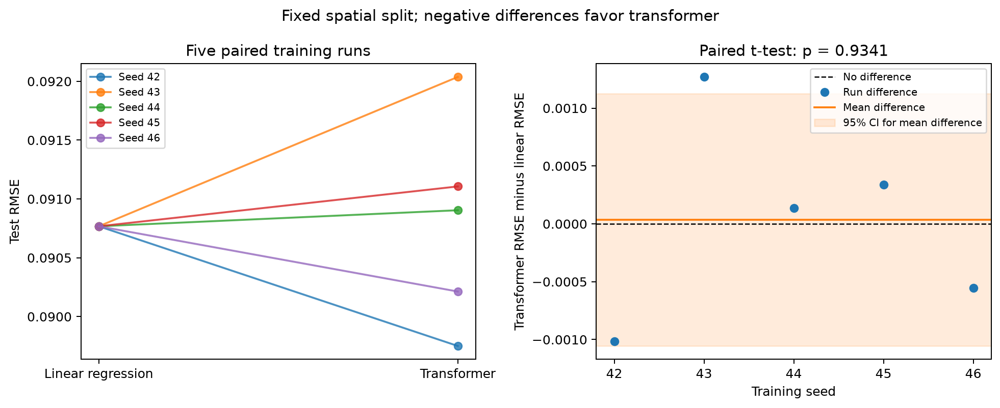
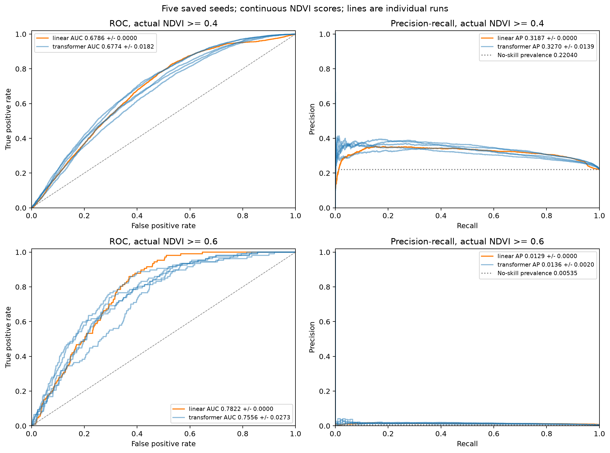
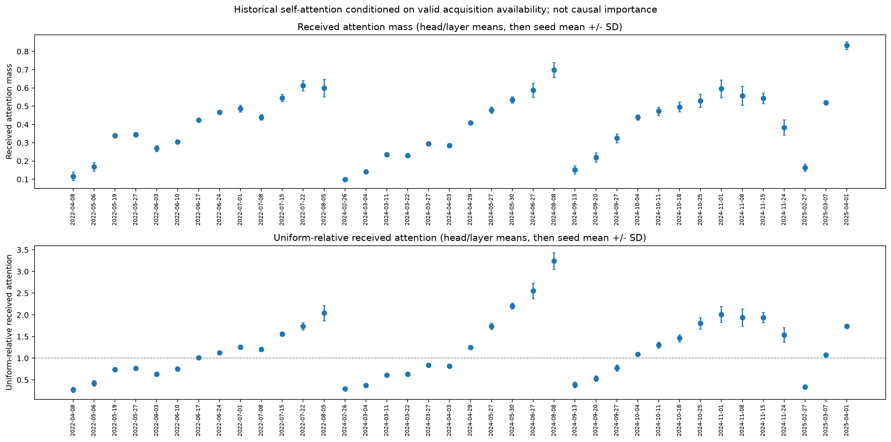

# Strawberry UAV NDVI forecasting research

A public research-sharing fork of [ArCo Group's ndvi-forecasting](https://github.com/arco-group/ndvi-forecasting), with a UAV NDVI forecasting adaptation and verified comparison results. This fork and its local sharing clone are separate from the original upstream project and the author's working research folder.

## Start here for presentation or AI review

1. **[Complete presentation brief](Research/docs/presentation-brief.md)**: data, models, experiments, tests, findings and proposal gaps.
2. **[AI reading guide](AI_CONTEXT.md)**: scope and claims to avoid.
3. **[Five-run comparison](Research/runs/model_comparison/five_seed_2026-11-18/comparison.md)** and **[individual scores](Research/runs/model_comparison/five_seed_2026-11-18/paired_scores.csv)**.
4. **[Repository map](Research/docs/repository-map.md)** and **[adaptation review](Research/docs/upstream-review.md)**.
5. **[New ROC/AP and attention presentation summary](Research/analysis_results/five_seed_posthoc_2026-11-19/presentation_summary.txt)**, **[per-seed metrics](Research/analysis_results/five_seed_posthoc_2026-11-19/ranking_metrics_all_seeds.csv)**, and **[new analysis code](Research/analysis/five_seed_posthoc.py)**.

## Main result

Five seeds (42-46), the same spatial split and 20,000 matched test samples per run:

| Model | Mean test RMSE | Sample SD across runs |
| --- | ---: | ---: |
| Transformer | 0.090802 | 0.000878 |
| Linear regression | 0.090768 | 0.000000 |

The exploratory two-sided paired t-test gave **t(4)=0.088003, p=0.934104**. The 95% CI for transformer-minus-linear mean RMSE is [-0.001055323, 0.001124413]. The test did not detect a mean difference and does not establish equivalence.



The split holds out geographic locations, not whole acquisition dates. Seeds vary transformer training on fixed data; OLS is deterministic. Neither fitted model predicted healthy-category test samples in these runs. Three-class performance was weak despite accuracy near the majority-category percentage.

## Added post-hoc analysis: no retraining

Existing five-seed predictions and checkpoints were analyzed separately. Binary targets are actual NDVI >= 0.4 (marginal-or-healthy) and >= 0.6 (healthy); raw continuous predictions are the ranking scores.

| Positive target | Model | Mean ROC-AUC | Mean Average Precision |
| --- | --- | ---: | ---: |
| NDVI >= 0.4 | Linear regression | 0.678647 | 0.318651 |
| NDVI >= 0.4 | Transformer | 0.677448 | 0.326986 |
| NDVI >= 0.6 | Linear regression | 0.782233 | 0.012884 |
| NDVI >= 0.6 | Transformer | 0.755555 | 0.013638 |

[Full means and seed SDs](Research/analysis_results/five_seed_posthoc_2026-11-19/ranking_metrics_summary.csv). The healthy-target prevalence is 0.00535, so interpret precision-recall relative to that low baseline. These are two binary ranking tasks, not calibrated three-class probabilities. No new significance tests were performed for AUC/AP.



Historical self-attention was recovered across all four layers and eight heads for all 20,000 test samples per seed. [Attention date summary](Research/analysis_results/five_seed_posthoc_2026-11-19/attention_date_seed_summary.csv), support counts, per-seed heatmaps, and illustrative per-head arrays are included. Attention describes historical-token mixing, not causal importance or target-to-history cross-attention.



[HTML report source/download](Research/analysis_results/five_seed_posthoc_2026-11-19/report.html) (download and open locally to render). The working-project integrity audit found 771 protected files unchanged, and nine isolated analysis tests passed. The original models and previous results were not edited or retrained. The public snapshot omits the local raw-file inventory, raw illustrative NDVI values and pixel coordinates; derived attention arrays/dates remain available.

To run only the new tests after environment setup, from `Research/`:

```powershell
python -B -m pytest analysis/test_five_seed_posthoc.py -q -p no:cacheprovider
```

Full extraction still requires the unshared original checkpoints and test cache. Published results are ready to inspect without those inputs.

## Layout and provenance

- `Research/`: UAV adaptation, configurations, tests, guides and compact result summaries/plots.
- `agrimatnet/`, `dataset_builder/`: original upstream source.
- `UPSTREAM_README.md`: original upstream README.
- `LICENSE` and `Research/src/uav_ndvi/licenses/AgriMatNet-LICENSE`: retained original copyright and MIT terms.
- `SHARING_MANIFEST.json`: copied-file checksums and exclusions.

The adaptation records upstream commit `93ca6fae1acb4cbde9f4f8494fb8ee0029f205fe` as its source basis. This branch adds the UAV snapshot without submitting changes to the original repository.

## Run synthetic software tests

```powershell
cd Research
python -m venv .venv
.\.venv\Scripts\Activate.ps1
python -m pip install -r requirements.txt
python -m pytest -q
python -m uav_ndvi --help
```

The full working project passed 25 tests. This sharing snapshot omits local research checkpoints, so its optional historical-checkpoint case is expected to skip. Synthetic tests create temporary inputs/models. They do not estimate strawberry forecasting performance.

## Check the paired statistic independently

From `Research/`, with dependencies installed:

```python
import pandas as pd
from scipy.stats import ttest_rel
scores = pd.read_csv("runs/model_comparison/five_seed_2026-11-18/paired_scores.csv")
print(ttest_rel(scores.transformer_rmse, scores.linear_rmse))
```

## Sharing scope

Included: source, configurations, documentation, aggregate numerical results and selected diagnostic figures. Excluded: raw UAV rasters, aligned caches, sample arrays, trained research checkpoints, per-pixel prediction CSVs, credentials and the virtual environment. Machine-specific paths were redacted in this copy. Upstream files already in the public fork history remain part of that history.

A fresh clone can run synthetic tests and inspect saved scores. Reproducing real-data training still requires the original rasters/cache/examples; summary files do not replace those inputs. Some historical guides describe the complete local project, rather than files available in this public snapshot.

## Safe fork workflow

The prepared local clone uses `origin` for the author's GitHub fork. The ArCo Group remote is named `upstream`, with its push URL disabled. No upstream push or pull request is part of this sharing task. Your working Research folder is separate and was only read while preparing the snapshot.
