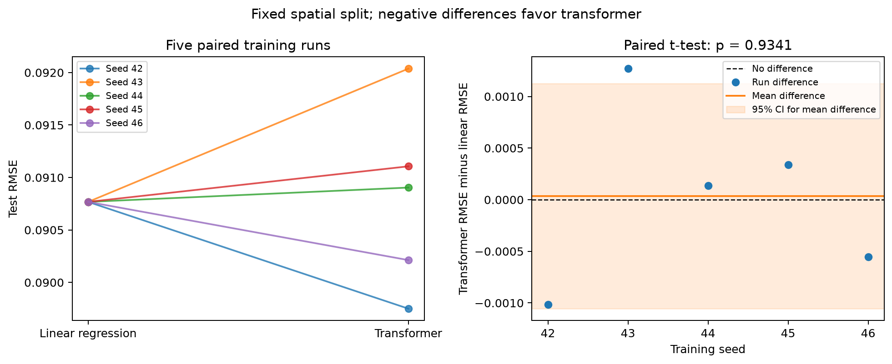

# Repeated fixed-split comparison

Paired runs: 5. Each run uses the same test samples.

| Model | Mean test RMSE | Sample standard deviation |
| --- | ---: | ---: |
| transformer | 0.09080212 | 0.00087775 |
| linear | 0.09076757 | 0.00000000 |

Mean paired difference (transformer minus linear): 0.00003454.

Two-sided paired t-test: t(4) = 0.088003, p = 0.934104. 95% confidence interval for the mean difference: [-0.00105532, 0.00112441].

A negative difference favors the transformer. Linear regression is deterministic on fixed samples, so identical linear scores are expected and are not independent datasets. The t-test uses one difference per training seed, not one per pixel.

Training-seed variability conditional on this fixed training, validation and test dataset. Not uncertainty across new fields, years or independent datasets. Assumes independent seed realizations and approximately normal run-level differences. The test set was evaluated previously; treat this as an exploratory comparison.

With few repeats, the normal-difference assumption is difficult to assess. A small p-value here does not establish superiority on unseen dates or fields.

[SciPy paired t-test documentation](https://docs.scipy.org/doc/scipy/reference/generated/scipy.stats.ttest_rel.html)

## Interpretation

The two-sided test did not detect a mean RMSE difference at alpha=0.05 (p=0.934104). The confidence interval crosses zero. These five seed repetitions do not provide evidence that the transformer outperforms linear regression on this fixed split. Failure to reject the null does not establish equivalence or prove there is no difference.

